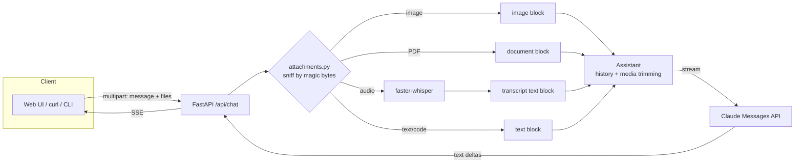

# 🖼️🎙️📄 Multi-Modal AI Assistant

Chat with [Claude](https://www.anthropic.com) using **text, images, PDFs and voice** in one conversation. Drop in a screenshot, a contract, a voice note or a code file, ask a question, and get a streamed answer that is grounded in what you attached.

It ships as a **web UI**, a **streaming REST API** and a **CLI**, all on one small, well-tested core.

## Table of contents

- [Features](#features)
- [How it works](#how-it-works)
- [Quick start](#quick-start)
- [Using it](#using-it)
- [REST API](#rest-api)
- [Configuration](#configuration)
- [Design notes](#design-notes)
- [Security](#security)
- [Project layout](#project-layout)
- [Testing](#testing)
- [Limitations and roadmap](#limitations-and-roadmap)
- [Contributing](#contributing)

## Features

| Input | What happens |
|---|---|
| **Images** (PNG, JPEG, GIF, WebP) | Sent to Claude as native vision input |
| **PDFs** | Sent as native document input (text and page visuals) |
| **Audio** (WAV, MP3, OGG, WebM, FLAC, M4A) | Transcribed locally with faster-whisper, then sent as text |
| **Text and code files** (`.txt`, `.md`, `.csv`, `.json`, `.py`, ...) | Inlined as text (large files are truncated) |

- **Streaming answers** over Server-Sent Events: text appears as it is generated.
- **Web UI** with drag and drop, paste-a-screenshot, file picker and a built-in **voice recorder**.
- **Conversation memory** per session, with a sliding window.
- **Token-aware history:** images and PDFs are kept only for the most recent turns (default 2); older ones are replaced by a short placeholder in what the model sees, which cuts cost sharply in long chats.
- **Safe uploads:** file types are detected from the file's bytes, not its name; size limits per type; file names are sanitized.
- **Works offline in tests:** the whole stack is covered by 48 tests that need no API key, network or model download.

## How it works



Each user turn is `attachments first, then your text`, which is the order Claude handles best. Audio never leaves your machine as audio: it is converted to a transcript first.

## Quick start

**Requirements:** Python 3.10+ and an [Anthropic API key](https://console.anthropic.com) with credits.

```bash
git clone <your-repo-url> && cd multimodal-ai-assistant
python -m venv .venv && source .venv/bin/activate    # Windows: .venv\Scripts\activate
pip install -e ".[dev]"
# optional: voice notes / audio files
pip install -e ".[audio]"

export ANTHROPIC_API_KEY=...                         # Windows cmd: set ANTHROPIC_API_KEY=...
multimodal-assistant serve                           # open http://127.0.0.1:8000
```

If an antivirus blocks the `multimodal-assistant` launcher on Windows, run `python -m multimodal_assistant.cli serve` instead.

### Docker

```bash
docker build -t multimodal-ai-assistant .
# with audio support: docker build --build-arg EXTRAS="[audio]" -t multimodal-ai-assistant .
docker run --rm -p 8000:8000 -e ANTHROPIC_API_KEY multimodal-ai-assistant
```

## Using it

### Web UI

Open <http://127.0.0.1:8000>. Attach files with 📎, drag them anywhere on the page, paste a screenshot with `Ctrl+V`, or tap 🎤 to record a voice note (it is attached and transcribed when you press Send). **New chat** clears the conversation.

### CLI

```bash
multimodal-assistant ask "What is in this picture?" -f photo.jpg
multimodal-assistant ask "Summarize the key obligations" -f contract.pdf
multimodal-assistant ask "Compare these" -f a.png -f b.png
multimodal-assistant ask "Turn this voice note into a to-do list" -f note.m4a   # needs the audio extra
```

## REST API

`POST /api/chat` (`multipart/form-data`)

| Field | Required | Description |
|---|---|---|
| `session_id` | yes | 8-64 characters of `A-Z a-z 0-9 _ -`, chosen by the client; identifies the conversation |
| `message` | no* | Your text |
| `files` | no* | One or more attachments (max 5 by default) |

\* At least one of `message` or `files` is required.

The response is `text/event-stream`. Each event is one line `data: {json}`:

```text
data: {"type": "text", "text": "This looks like "}
data: {"type": "text", "text": "a golden retriever."}
data: {"type": "done"}
```

On failure the stream contains `{"type": "error", "text": "..."}`. Validation problems (bad session id, unsupported file, too many files) return HTTP `400`, oversized uploads `413`.

```bash
curl -N http://127.0.0.1:8000/api/chat \
  -F session_id=demo-session-1 \
  -F message="What does this chart show?" \
  -F files=@chart.png
```

Other routes: `DELETE /api/sessions/{session_id}` forgets a conversation, `GET /healthz` is a liveness probe, `GET /` serves the UI.

## Configuration

| Variable | Default | Description |
|---|---|---|
| `ANTHROPIC_API_KEY` | required | Read by the Anthropic SDK |
| `ANTHROPIC_MODEL` | `claude-sonnet-5-5` | Any Claude model with vision and PDF support |
| `MAX_TOKENS` | `1500` | Max length of each answer |
| `SYSTEM_PROMPT` | built-in | Persona and rules for the assistant |
| `MAX_TURNS` | `10` | Conversation turns remembered per session |
| `MEDIA_TURNS` | `2` | Recent turns that keep their images/PDFs |
| `MAX_SESSIONS` | `100` | Sessions kept in memory (least recently used evicted) |
| `MAX_FILES_PER_MESSAGE` | `5` | Attachments per message |
| `WHISPER_MODEL` | `base` | `tiny`, `base`, `small`, `medium`, `large-v3` |
| `WHISPER_DEVICE` / `WHISPER_COMPUTE_TYPE` | `cpu` / `int8` | Use `cuda` / `float16` on a GPU |
| `HOST` / `PORT` | `127.0.0.1` / `8000` | Bind address |

Size limits: images 5 MB, PDFs 20 MB, audio 25 MB, text files 1 MB.

## Design notes

- **Content sniffing, not trust.** `attachments.sniff` identifies PNG, JPEG, GIF, WebP, PDF and the common audio containers from magic bytes. A PNG renamed to `.pdf` is still treated as an image.
- **Media budget.** `strip_old_media` swaps old images and PDFs for a placeholder in the payload sent to the model, while the stored history stays intact. Answers from earlier turns already carry what mattered.
- **Clean failure handling.** If a turn fails or the model returns nothing, the unanswered user message is rolled back so the conversation never ends up with two user messages in a row. Internal error details are logged, never sent to the client.
- **One turn at a time per session.** A per-conversation lock queues overlapping requests instead of interleaving history.
- **Provider-agnostic core.** `LLM` and `Transcriber` are small `Protocol`s; the tests swap in fakes, and you can plug in another model or STT engine with one class.
- **Blocking work off the event loop.** Audio transcription runs in a worker thread.
- **XSS-safe UI.** The page only ever uses `textContent` for chat text, so model output or file names are never interpreted as HTML.

## Security

- Uploads are validated by content, size-limited and name-sanitized; unknown types are rejected.
- Session ids are strictly validated; sessions live in memory only and are never written to disk.
- The server binds to `127.0.0.1` by default. **There is no authentication or rate limiting.** Before exposing it beyond your machine, put it behind a reverse proxy with auth (and TLS, which browsers also require for microphone access off `localhost`), and add rate limits. Every request spends your API credits.
- Keep your API key in an environment variable or secret manager, never in the repository (`.env` is git-ignored).
- Documents and images are untrusted input to the model. A file can contain text that tries to steer the assistant, so do not wire this to tools with side effects without extra safeguards.

## Project layout

```
src/multimodal_assistant/
  attachments.py   sniffing, size limits, file -> Claude content block
  assistant.py     Conversation, Sessions (LRU), media trimming, the streaming turn
  llm.py           LLM protocol + async Claude streaming backend
  transcribe.py    Transcriber protocol + faster-whisper backend (optional extra)
  server.py        FastAPI app: /api/chat (SSE), sessions, health, UI
  cli.py           `multimodal-assistant serve | ask`
  config.py        env-driven settings
  web/index.html   single-file chat UI
tests/             48 offline tests (fake LLM and transcriber)
```

## Testing

```bash
pytest -q
ruff check .
```

Tests cover file-type detection and mislabeled files, size limits, audio transcription flow, history trimming and media stripping, rollback on failure, session isolation and eviction, and the full HTTP flow including SSE streaming and validation errors. CI runs both commands on Python 3.10 and 3.12 for every push to `main` and every pull request.

## Limitations and roadmap

- Sessions are in memory, so they reset when the server restarts and do not scale across multiple processes.
- No authentication, rate limiting or usage tracking.
- Answers are rendered as plain text (no Markdown rendering yet).
- Audio is transcribed, not understood directly, so tone and non-speech sounds are lost.
- Output is text only; there is no image or speech generation.

Ideas: Markdown rendering in the UI, text-to-speech replies, persistent sessions (SQLite), per-user auth, camera capture, URL and web-page attachments, tool use.

## Contributing

1. Fork and create a feature branch.
2. `pip install -e ".[dev]"`
3. Add tests with your change; keep `ruff check .` and `pytest` green.
4. Open a pull request describing the change and how you tested it.

## License

Add a `LICENSE` file of your choice (MIT is a common default) before publishing.
